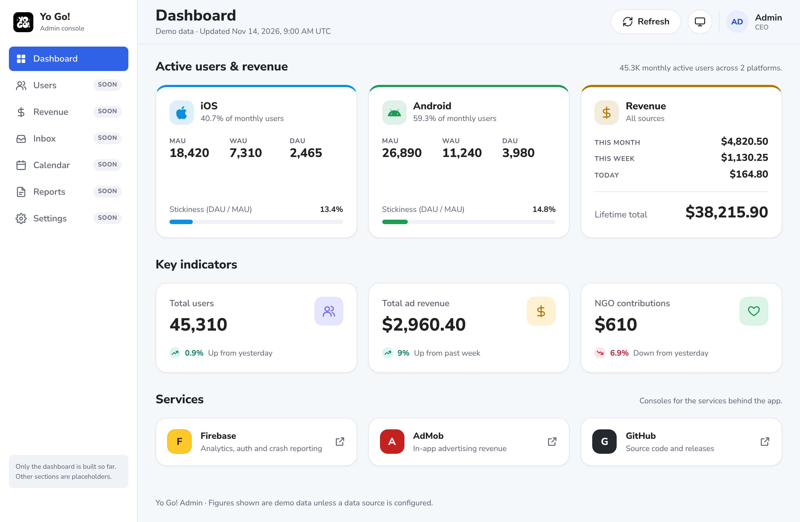
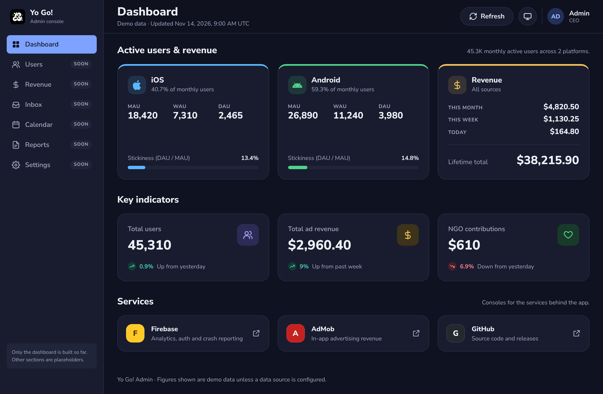
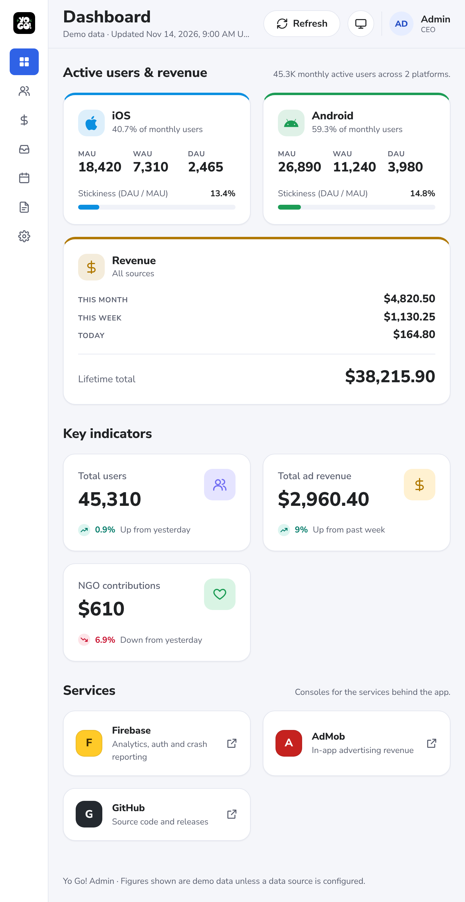
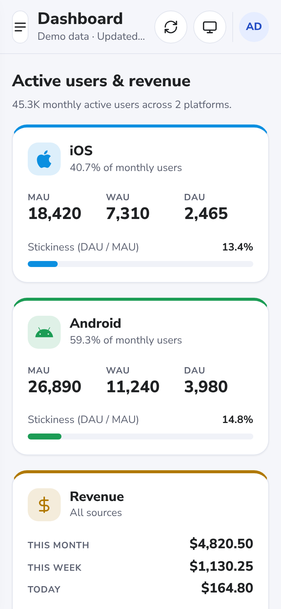
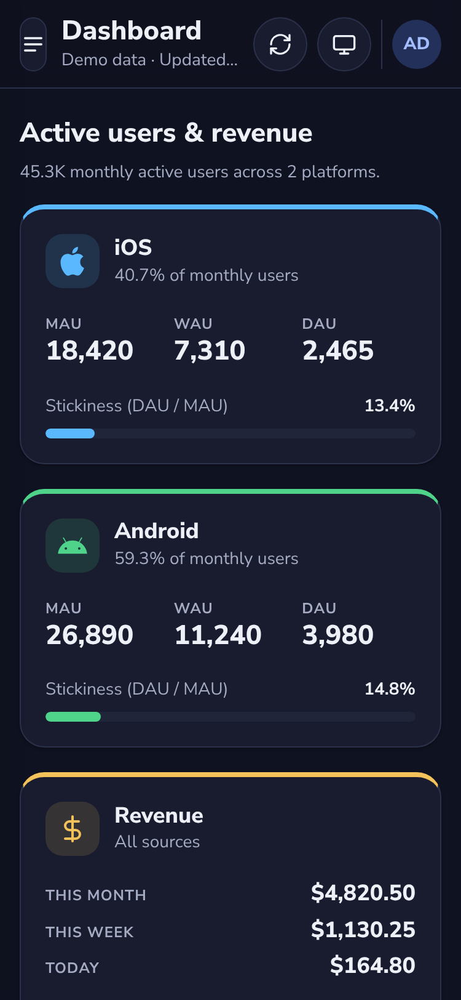
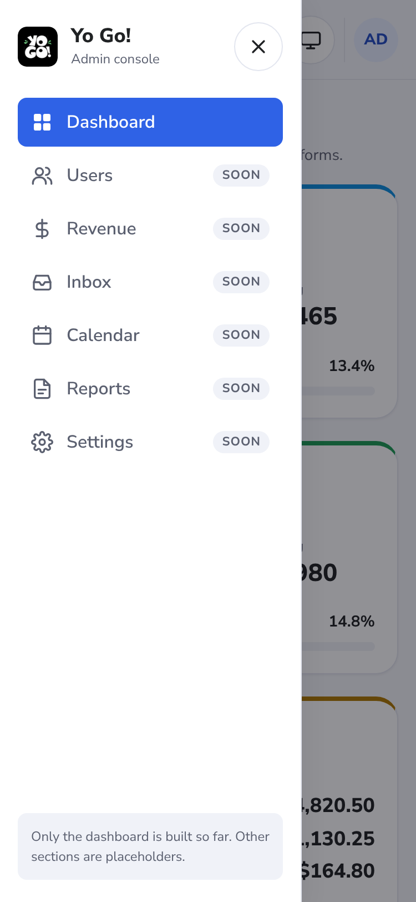
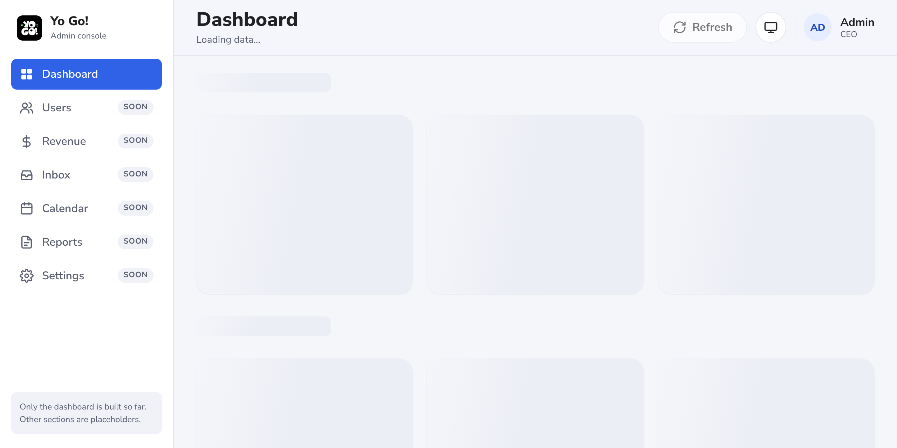
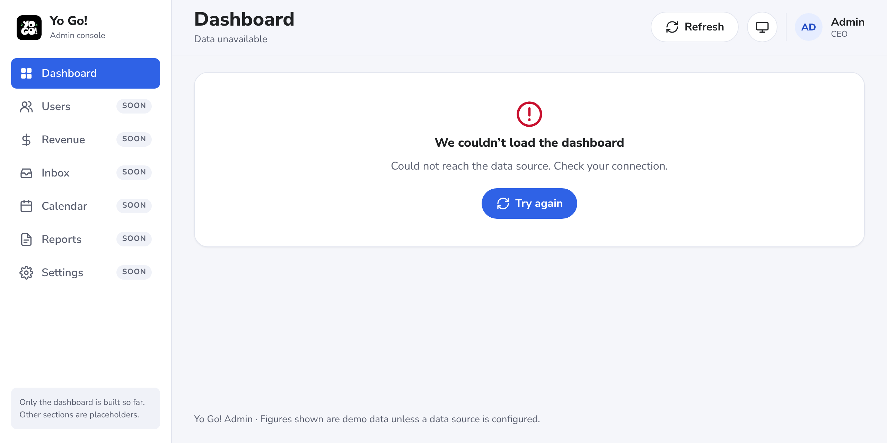
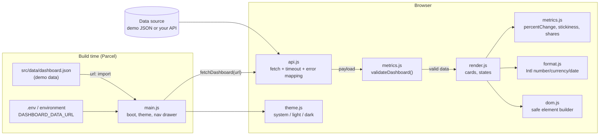

# Yo Go! Admin Dashboard

A fast, accessible admin dashboard for the **Yo Go!** app. It shows active users per platform, revenue and key indicators on one responsive page.




## Overview

The people who run a consumer app need a quick daily answer to three questions:

1. How many people are using it, and on which platform?
2. How much money is it making?
3. Are the key numbers going up or down?

This dashboard answers those questions on one screen. It started as a design exported from Locofy (a single fixed-width page with hardcoded zeros). It has since been rebuilt as a semantic, responsive, themeable page that renders from a JSON data source. It is a static site with no server or framework runtime. The JavaScript bundle is about 12 kB minified.

It's aimed at the Yo Go! team (admins and founders) and at developers who want a small, dependency-free dashboard to hook up to their own analytics endpoint.

> **Demo data:** out of the box, the dashboard renders the fictional figures in [`src/data/dashboard.json`](src/data/dashboard.json). The UI labels them as demo data until you configure a real source (see [Configuration](#configuration)).

## Screenshots

| Desktop (dark)                                                      | Tablet                                                  |
| ------------------------------------------------------------------- | ------------------------------------------------------- |
|  |  |

| Phone                                                 | Phone (dark)                                                    | Phone navigation drawer                                              |
| ----------------------------------------------------- | --------------------------------------------------------------- | -------------------------------------------------------------------- |
|  |  |  |

| Loading state                                            | Error state with retry                           |
| -------------------------------------------------------- | ------------------------------------------------ |
|  |  |

All screenshots were captured from the running app with the bundled demo data.

## Features

- **Active users per platform:** MAU, WAU and DAU for iOS and Android, each platform's share of monthly users, and a _stickiness_ meter (DAU ÷ MAU).
- **Revenue summary:** this month, this week, today and lifetime total, formatted in the payload's currency.
- **Key indicators with real trends:** each KPI compares `value` to `previous` and shows the percentage change. The up, down or flat icon and wording come from the actual numbers instead of being hardcoded.
- **Service shortcuts:** links to the Firebase, AdMob and GitHub consoles. They open in a new tab and come from the data file.
- **Payload validation:** malformed data (negative counts, DAU > MAU, bad currency code, non-https links…) produces a clear error state with technical details instead of a broken page.
- **Loading, empty and error states:** skeleton placeholders while loading, friendly empty cards and a retry button. Requests time out after 10 s.
- **Light, dark and system themes:** follows the OS by default. A toggle cycles _system → light → dark_, and the choice is saved with no flash on reload.
- **Responsive:** full sidebar at ≥1200 px, icon rail on tablets and an off-canvas drawer on phones (focus management, <kbd>Esc</kbd> to close). No horizontal scrolling at 375 px.
- **Accessible:** skip link, landmarks, heading hierarchy, labelled controls, visible focus rings, `role="meter"` for progress bars, live region for data updates, `prefers-reduced-motion` support, and WCAG AA contrast in both themes (checked with axe-core).
- **Safe rendering:** all data is inserted as text nodes, never `innerHTML`.
- **404 page**, favicon/touch icon, meta description and Open Graph tags.

## Tech stack

| Layer       | Choice                                                                        | Notes                                                 |
| ----------- | ----------------------------------------------------------------------------- | ----------------------------------------------------- |
| Markup      | Semantic HTML5                                                                | Inline SVG icon sprite (no icon font, no image icons) |
| Styling     | Hand-written CSS with custom-property design tokens                           | Light/dark palettes, 4 px spacing scale, type scale   |
| Logic       | Vanilla JavaScript (ES modules)                                               | No framework runtime                                  |
| Bundler     | [Parcel 2](https://parceljs.org/)                                             | Dev server with HMR, minified production build        |
| Font        | [Nunito Sans](https://fonts.google.com/specimen/Nunito+Sans) via Google Fonts | `display=swap`, system-font fallback                  |
| Tests       | Node's built-in test runner (`node:test`)                                     | No extra test dependencies                            |
| Lint/format | ESLint 9 (flat config), Stylelint, Prettier                                   |                                                       |

## Architecture



**Data flow:** `main.js` chooses the data URL, which is either the configured `DASHBOARD_DATA_URL` or the bundled demo file. `api.js` fetches it with a timeout and turns every failure (network, HTTP status, bad JSON, failed validation) into a `DashboardError` with a user-facing message. `render.js` builds the DOM from the validated payload, using the pure helpers in `metrics.js` and `format.js`. Those modules don't touch the DOM, which is why they can be unit-tested in Node.

## Project structure

```text
.
├── index.html               # Dashboard page: layout shell, icon sprite, meta/OG tags
├── 404.html                 # Not-found page (served by most static hosts automatically)
├── public/                  # Favicon, touch icon, Open Graph image (Yo Go! logo)
├── src/
│   ├── data/
│   │   └── dashboard.json   # Demo payload: also the reference for the data schema
│   ├── js/
│   │   ├── main.js          # Entry point: loads data, wires theme toggle, refresh, mobile nav
│   │   ├── api.js           # fetchDashboard() + DashboardError
│   │   ├── metrics.js       # Pure calculations + payload validation
│   │   ├── format.js        # Intl-based number/currency/percent/date formatting
│   │   ├── render.js        # Builds cards and loading/empty/error states
│   │   ├── dom.js           # Minimal, injection-safe DOM builder + icon helper
│   │   └── theme.js         # Theme preference parsing, cycling, persistence
│   └── styles/
│       └── main.css         # Design tokens, components, responsive rules, dark theme
├── tests/                   # node:test unit tests (format, metrics, api, theme)
├── docs/screenshots/        # Screenshots used in this README
├── .parcelrc                # Ships the demo JSON as a raw file instead of a JS module
├── .env.example             # Documented configuration variables
├── eslint.config.js         # ESLint flat config
├── .stylelintrc.json        # Stylelint config
├── .prettierrc.json         # Prettier config
└── package.json
```

## Getting started

### Prerequisites

- **Node.js 22 or newer** (an `.nvmrc` is included: `nvm use`)
- **npm 10+** (bundled with Node 22)

### Installation

```bash
git clone https://github.com/jeevithg090/test-090.git
cd test-090
npm ci          # or: npm install
```

### Run in development

```bash
npm start
```

Open <http://localhost:1234>. Parcel rebuilds and hot-reloads on every save.

### Build for production

```bash
npm run build      # outputs static files to ./build
npm run preview    # serves ./build on http://localhost:4173 (downloads `serve` via npx)
```

The `build/` folder is entirely static and can be served by any web server or static host.

## Configuration

Configuration goes through environment variables, which Parcel **inlines at build time**. Copy the example file and edit it:

```bash
cp .env.example .env
```

| Variable             | Required | Default                              | Description                                                                                                                                                                                                       |
| -------------------- | -------- | ------------------------------------ | ----------------------------------------------------------------------------------------------------------------------------------------------------------------------------------------------------------------- |
| `DASHBOARD_DATA_URL` | No       | _(empty: bundled demo data is used)_ | URL of a JSON endpoint returning the dashboard payload. It can be absolute or relative to the page. Cross-origin endpoints must send CORS headers. When set, the header shows "Live data" instead of "Demo data". |

> Because the value is baked into the bundle, **don't put secrets in it**. Anyone who loads the page can read it. If your analytics API needs a key, put a small server-side proxy in front of it.

### Data format

The endpoint must return JSON shaped like [`src/data/dashboard.json`](src/data/dashboard.json):

```jsonc
{
  "generatedAt": "2026-11-14T09:00:00Z", // ISO timestamp shown in the header
  "currency": "USD", // ISO 4217 code
  "platforms": [
    // DAU ≤ WAU ≤ MAU is enforced
    { "id": "ios", "name": "iOS", "mau": 18420, "wau": 7310, "dau": 2465 },
  ],
  "revenue": { "monthly": 4820.5, "weekly": 1130.25, "today": 164.8, "lifetime": 38215.9 },
  "kpis": [
    {
      "id": "total-users", // "total-users" | "ad-revenue" | "ngo" pick an icon
      "label": "Total users",
      "format": "number", // "number" | "currency"
      "value": 45310,
      "previous": 44890, // used to compute the trend
      "comparedTo": "yesterday", // rendered as "Up from yesterday"
    },
  ],
  "integrations": [
    // optional; links must be https://
    {
      "id": "firebase",
      "name": "Firebase",
      "description": "…",
      "url": "https://console.firebase.google.com/",
    },
  ],
}
```

Platform ids `ios` and `android` get brand icons and colours. Any other id gets a generic icon.

## Usage

1. **Read the overview.** Each platform card shows MAU, WAU and DAU (hover the abbreviation for its full name), the platform's share of all monthly users, and stickiness. The revenue card lists this month, this week, today and the lifetime total.
2. **Check the indicators.** Green arrows mean the value went up compared with the period in `comparedTo`. Red means down, and a flat line means no meaningful change (below 0.05%).
3. **Refresh** re-fetches the data source without reloading the page.
4. **Theme toggle** (monitor, sun or moon icon) cycles system → light → dark. The choice is remembered per browser.
5. **On phones**, the menu button opens the navigation drawer. Close it with ✕, by tapping the backdrop or with <kbd>Esc</kbd>.

### Previewing UI states

For design and QA work you can force each state against the demo data with a query parameter:

| URL                                    | Shows                                 |
| -------------------------------------- | ------------------------------------- |
| `http://localhost:1234/?state=loading` | Skeleton placeholders (stays loading) |
| `http://localhost:1234/?state=error`   | Error card with **Try again**         |
| `http://localhost:1234/?state=empty`   | Empty-state cards for each section    |

## Scripts

| Command                     | What it does                                                            |
| --------------------------- | ----------------------------------------------------------------------- |
| `npm start` / `npm run dev` | Start the Parcel dev server on port 1234 with hot reload                |
| `npm run build`             | Production build into `build/` (minified, hashed assets, relative URLs) |
| `npm run preview`           | Serve `build/` locally on port 4173                                     |
| `npm test`                  | Run the unit tests with `node --test`                                   |
| `npm run lint`              | ESLint (JS) + Stylelint (CSS)                                           |
| `npm run lint:fix`          | Same, applying automatic fixes                                          |
| `npm run format`            | Format everything with Prettier                                         |
| `npm run format:check`      | Check formatting without writing                                        |
| `npm run check`             | Lint, format check, tests and build in one go: run before pushing       |
| `npm run clean`             | Remove `build/`, `dist/` and `.parcel-cache/`                           |

## Testing

```bash
npm test
```

There are 32 unit tests in `tests/` covering the logic the UI depends on:

| File              | Covers                                                                                                                                                                     |
| ----------------- | -------------------------------------------------------------------------------------------------------------------------------------------------------------------------- |
| `format.test.js`  | Number, compact, currency (whole vs. fractional), percent and UTC date formatting; non-finite input                                                                        |
| `metrics.test.js` | `percentChange` (incl. zero/negative baselines), trend direction and wording, stickiness, totals, platform share, and `validateDashboard` (including the demo file itself) |
| `api.test.js`     | Successful fetch, request headers, HTTP errors, network failure, timeout, invalid JSON, schema failures                                                                    |
| `theme.test.js`   | Theme parsing, cycling, resolution against the OS setting, and storage that throws                                                                                         |

The DOM layer (`render.js`, `main.js`) was verified manually in a real browser with Playwright at 375, 768, 1280 and 1440 px in both themes, plus an axe-core accessibility scan. Those browser checks aren't part of `npm test`.

## Linting & formatting

- **ESLint 9** (`eslint.config.js`): recommended rules plus `eqeqeq`, `prefer-const` and no stray `console.log`.
- **Stylelint** (`stylelint-config-standard`): consistent, modern CSS (e.g. media-query range syntax).
- **Prettier**: single quotes, 100-column lines.
- **EditorConfig**: 2-space indentation, LF line endings.

## Deployment

The production build is a folder of static files, so any static host works:

| Host             | Settings                                                                                                                                    |
| ---------------- | ------------------------------------------------------------------------------------------------------------------------------------------- |
| **Netlify**      | Build command `npm run build`, publish directory `build`. `404.html` is picked up automatically.                                            |
| **Vercel**       | Framework preset "Other", build `npm run build`, output `build`.                                                                            |
| **GitHub Pages** | Run `npm run build` and publish the contents of `build/` (e.g. to a `gh-pages` branch). Asset URLs are relative, so project sub-paths work. |
| **Nginx/Apache** | Copy `build/` to the web root and set `error_page 404 /404.html;` (Nginx) or `ErrorDocument 404 /404.html` (Apache).                        |

Set `DASHBOARD_DATA_URL` in the host's build environment if you have a live endpoint.

For rich link previews, change the `og:image` meta tag in `index.html` to an **absolute** URL on your domain (Open Graph scrapers ignore relative URLs).

## Troubleshooting

<details>
<summary><strong>The page says "We couldn't load the dashboard"</strong></summary>

Open **Technical details** on the error card. Common causes:

- **HTTP 404 / network error:** `DASHBOARD_DATA_URL` is wrong, or the endpoint is down.
- **"unexpected shape":** the payload doesn't match the schema. The details list each problem (for example `platforms[0] must satisfy DAU ≤ WAU ≤ MAU`).
- **Blocked by CORS** (visible in the browser console): the endpoint must send `Access-Control-Allow-Origin` for the dashboard's origin.

</details>

<details>
<summary><strong>I changed <code>DASHBOARD_DATA_URL</code> but nothing happened</strong></summary>

The value is inlined at build time. Restart `npm start`, or rebuild. If it still looks stale, run `npm run clean` to clear the Parcel cache.

</details>

<details>
<summary><strong><code>npm test</code> fails with "Cannot find module …/tests"</strong></summary>

You are on Node < 22. The test script uses a glob pattern, which `node --test` supports from Node 21+. Run `nvm use` (or install Node 22).

</details>

<details>
<summary><strong>Port 1234 is already in use</strong></summary>

Run `npx parcel --port 3000` (or any free port).

</details>

<details>
<summary><strong>Fonts look different offline</strong></summary>

Nunito Sans is loaded from Google Fonts. Without network access the page falls back to the system UI font, and the layout is unaffected.

</details>

## Known limitations

- **Single page:** only the dashboard exists. Sidebar entries other than _Dashboard_ are placeholders and marked **Soon**.
- **No authentication:** the "Admin / CEO" profile chip is static. Put the site behind your host's access control if the data is sensitive.
- **Build-time configuration:** changing the data source requires a rebuild.
- **No historical charts:** cards show current values and a single comparison, not time series.
- **Client-side fetch only:** the endpoint must be reachable from the browser (CORS) and must not need secret credentials.

## Roadmap ideas

- Time-series charts (e.g. 30-day DAU per platform) with an accessible table fallback
- Date-range picker and per-period comparisons
- Auto-refresh interval and "last updated N minutes ago"
- Runtime configuration (`config.json`) so one build can target different environments
- Build out the placeholder sections (users, revenue breakdown, reports)
- Browser tests for the DOM layer (Playwright) as part of `npm run check`

## Contributing

1. Fork and create a feature branch.
2. `npm ci`, then make your change.
3. Run `npm run check` (lint, format check, tests and build must all pass).
4. Use [Conventional Commits](https://www.conventionalcommits.org/) (`feat:`, `fix:`, `docs:` …) and open a pull request with screenshots for UI changes.

When changing the data schema, update `src/data/dashboard.json`, `validateDashboard()` in `src/js/metrics.js`, the tests and the [Data format](#data-format) section together.

## License

No license has been chosen yet, so all rights are reserved by default. If you intend others to reuse the code, consider adding a permissive license such as **MIT**.

Third-party names and logos (Apple/iOS, Android, Firebase, AdMob, GitHub) are trademarks of their respective owners and are used only to identify the services.
